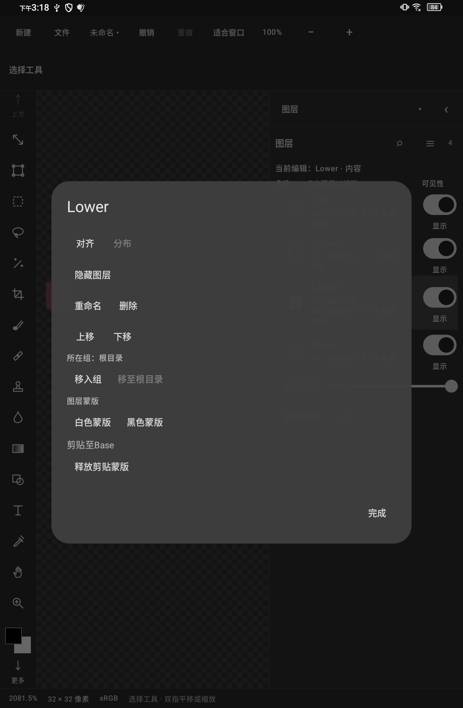
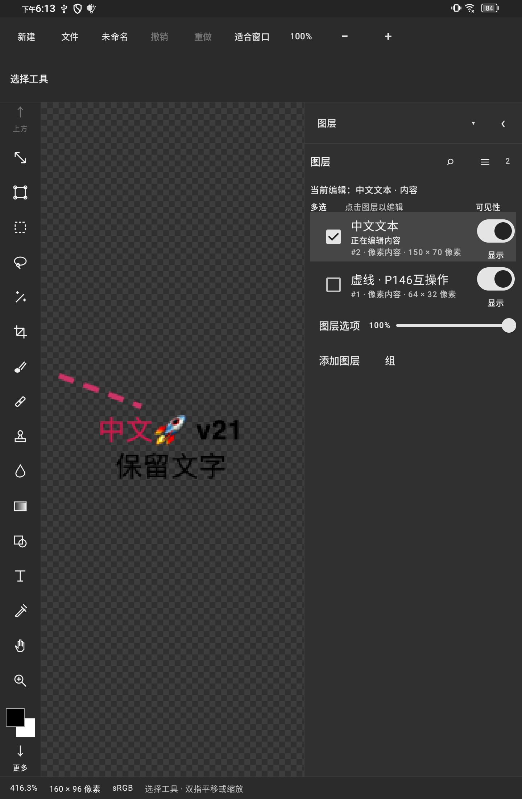
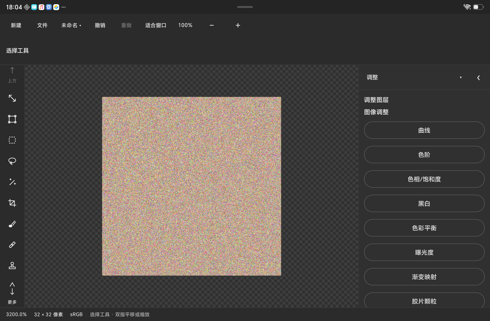

# Compositor for Android

原生 Android 图层图像编辑器，移植自 [Compositor for macOS](https://github.com/robbietilton/Compositor)。面向需要在手机或平板上进行合成、蒙版、选区和修图的用户。编辑和工程保存以本地工作区为主，无需登录。

**当前状态：开发预览 · Android 12+ · 简体中文 / English · P164。** 桌面对照基线是 macOS 版 **1.6.12**（`cc99ba3`）。Android 已有实际编辑和项目保存流程，尚未达到桌面版全功能、像素一致或正式发布验收。

## 应用实拍

以下是运行中的 Android 应用，由荣耀和 A06 设备截取，使用测试项目。截图来自早期真机验证版本，不是 P164 最新包的真机验收。

| 荣耀：图层菜单 | A06：中文文字工程回读 |
| --- | --- |
|  |  |

**荣耀横屏：调整 Inspector**



拍摄设备、版本和场景见[截图说明](docs/screenshots/README.md)。

## 已实现

| 领域 | 可用能力 |
| --- | --- |
| 图层与画布 | 多图层、分组、剪贴、蒙版、混合、显隐、图层搜索和筛选、对齐与分布，撤销和重做。 |
| 工具 | 移动/变换、扭曲、矩形选区、套索、魔棒、裁剪、画笔/橡皮、污点修复、仿制图章、涂抹、渐变、形状、文字、吸管、手形和缩放。 |
| 文字与形状 | 中文输入和可编辑文字图层，基础形状及多种线型；高级段落、字体和 PC 1.6.12 的形状样式仍有差距。 |
| 调整层 | 反相、曝光、色阶、曲线、黑白、色彩平衡、色相/饱和度、渐变映射、颗粒、添加杂色、暗角；范围内支持参数编辑和预览。 |
| 工程 | 本地新建、打开、更新原工程、另存副本和自动恢复，使用系统文件选择器交换图像及工程。支持 `.comp` 的一部分版本与内容，见[路线](docs/ROADMAP.md)。 |
| 导入与导出 | PNG/JPEG、受限 PNG16/TIFF 等导入；PNG、JPEG、合成 TIFF、源图层 TIFF 导出。P164 支持前三种格式按比例改宽高，以及 25% / 50% / 75% / 100% / 200% 档位。 |
| 本地化与输入 | 简体中文、English、部分实体键盘快捷键和系统快捷键帮助；触摸与原生面板，布局按移动端空间取舍。 |

## 架构与构建

`apps/android/` 是完整 Android 应用工程：Kotlin、Jetpack Compose 原生界面，通过 JNI 调用 C/C++ 编辑引擎。图层、选区、工程 IO 和软件合成由原生核心承担；画布具有 GLES 瓦片显示路径和 CPU 回退。

本仓库公开 Android 源码、测试和必要的互操作素材。引擎暂以两份 ABI 21 预编译库提供：`arm64-v8a` 与 `x86_64`，构建时校验 SHA-256。当前检出可构建 APK，但不能重新编译原生引擎，详见[原生库说明](docs/NATIVE_ENGINE.md)。

准备 **JDK 17、Android SDK Platform 35**，通过 `ANDROID_HOME` 或 Android Studio 指定 SDK。用 Android Studio 打开 `apps/android`，或在仓库根目录运行：

```sh
./apps/android/gradlew -p apps/android :app:assembleDebug :app:assembleDebugAndroidTest :app:lintDebug
python3 scripts/android-localization-check.py
python3 scripts/android-native-check.py apps/android/app/build/outputs/apk/debug/app-debug.apk
```

首次构建需要下载 Gradle 和 Android 依赖。当前预编译库路径不需要 NDK/CMake。生成的调试 APK 在 `apps/android/app/build/outputs/apk/debug/app-debug.apk`。测试 APK 的生成只代表编译完成，设备上的运行另外验收。

## 进度与许可

P164 的主机 TIFF 测试已验证缩放后的尺寸、像素、透明度、DPI、预算和取消。Android 有历史真机专项，但当前公开检出的新包尚未安装或运行真机。优先任务为 [v22 互操作、核心像素差异、最新包设备回归与剩余产品能力](docs/ROADMAP.md)。

仓库原有 [Apache-2.0 许可证](LICENSE)保留。来自上游 Compositor 的代码及其衍生部分保留 [MIT 版权与许可证](LICENSES/Compositor-MIT.txt)，其余第三方组件遵循[各自许可声明](apps/android/app/src/main/assets/THIRD_PARTY_NOTICES.txt)。这是独立 Android 移植项目。
