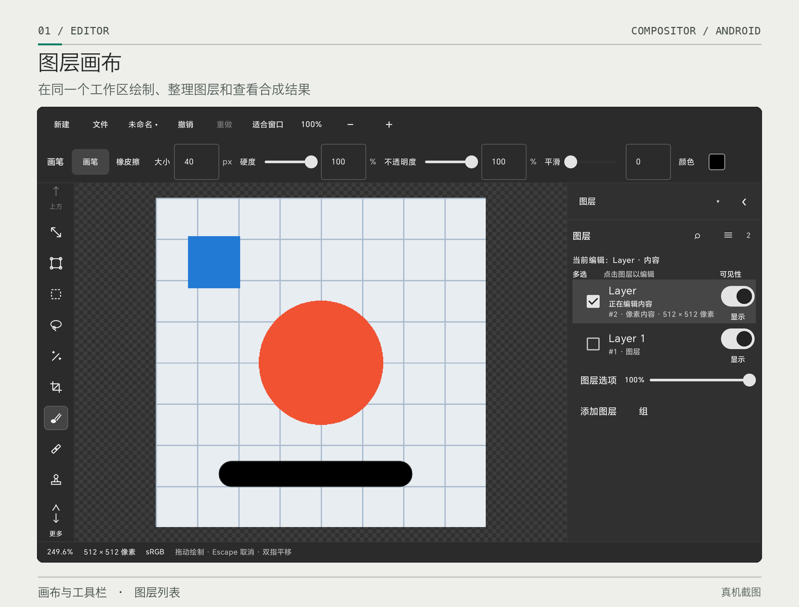
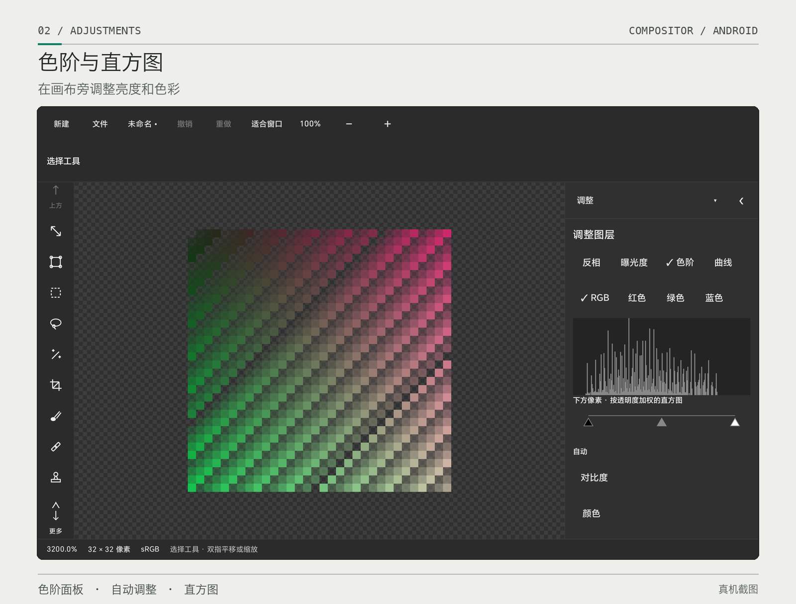
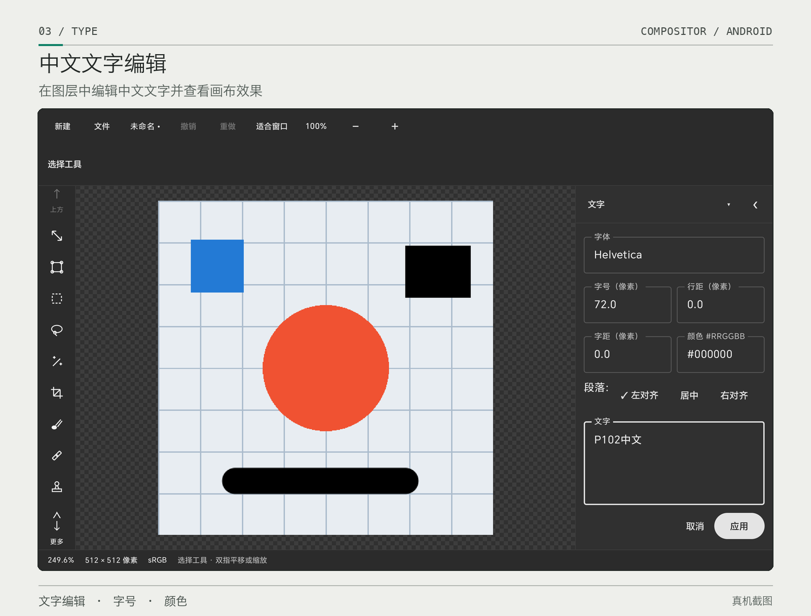

# Compositor for Android

**在 Android 上做图层合成、蒙版、选区和修图。** 本项目移植自 [Compositor for macOS](https://github.com/robbietilton/Compositor)，保留桌面版按图层组织和编辑的工作流，并为手机和平板提供原生触摸界面。编辑和保存均可在本地完成，无需登录。

**开发预览 P210 · Android 12+ · 简体中文 / English。** 蒙版对照基线为 macOS 版 **1.6.13**（`1910aea`）。本次更新接入 `.comp` v22 的兼容子集、Alt＋方向键复制并移动图层，并改进独立栅格蒙版的像素对齐。

[快速上手](#快速上手) · [格式支持](#格式支持) · [构建与验证](#构建与验证) · [桌面对齐路线](docs/ROADMAP.md)



## 快速上手

1. 点「新建」创建画布，或通过「文件」导入图像或打开已有工程。打开桌面工程前，先确认它使用的格式版本与图层类型在支持范围内。
2. 在图层面板选择要编辑的图层。用画笔、选区或蒙版处理局部；添加调整层可以保留原图，再随时回到调整面板修改参数。用撤销和重做比较前后结果。
3. 从「文件」保存本地可编辑工程或保存工程副本。重新打开后可继续编辑。若启动时提示恢复上一个文档，可先检查恢复内容，再保存成工程；恢复副本与显式保存的工程分别保留。
4. 分享图片时使用「导出为」，选择 PNG、JPEG 或 TIFF，输入宽高或选缩放档位。跨设备继续编辑时，选择「导出工程副本」，保留可编辑内容。

## 真机截图

| 色阶与直方图 | 中文文字编辑 |
| --- | --- |
| [](docs/screenshots/levels-workspace.png) | [](docs/screenshots/type-workspace.png) |

展示图取自以往的真机验证，使用测试素材，仅裁去系统栏并统一排版。当前包的真机回归另行验收。见[截图说明](docs/screenshots/README.md)。

## 已实现

| 领域 | 可用能力 |
| --- | --- |
| 图层与画布 | 多图层、分组、剪贴、蒙版、混合、显隐、图层搜索和筛选、对齐与分布，撤销和重做。 |
| 工具 | 移动/变换、扭曲、矩形选区、套索、魔棒、裁剪、画笔/橡皮、污点修复、仿制图章、涂抹、渐变、形状、文字、吸管、手形和缩放。 |
| 文字与形状 | 中文输入和可编辑文字图层，支持基础字号、颜色、对齐、形状和多种线型。 |
| 调整层 | 反相、曝光、色阶、曲线、黑白、色彩平衡、色相/饱和度、渐变映射、颗粒、添加杂色、暗角；范围内支持参数编辑和预览。 |
| 工程 | 新建和打开、保存本地工程、另存副本、自动恢复，以及通过系统文件选择器交换图像和工程。 |
| 导入与导出 | 「导出为」支持调整合成图宽高和锁定比例，提供 25%、50%、75%、100%、200% 缩放档位。 |
| 本地化与输入 | 简体中文、English、部分实体键盘快捷键和系统快捷键帮助；触摸与原生面板，布局按移动端空间取舍。 |

## 格式支持

| 格式 | 导入 / 打开 | 导出 / 保存 |
| --- | --- | --- |
| PNG / JPEG | 常规 sRGB 图像。PNG 16 位有受支持的导入子集。 | 合成图可按尺寸输出。需要透明背景选 PNG；输出 JPEG 时可选背景色。 |
| WebP / HEIC / HEIF | 通过 Android 解码器读取受支持的 sRGB 图像；能力受系统解码器、色彩空间和内存限制。 | 当前无对应导出选项。 |
| TIFF | 支持部分 TIFF 和高位深素材，受压缩、色彩和资源预算限制。 | 可导出合成 TIFF 或源图层 TIFF。源图层 TIFF 不包含合成效果。 |
| `.comp` 工程 | 可读取 v1–v22 和历史 v27 的受支持子集。对于会改变渲染结果的未支持设置（如 v22 形状描边），会提示并保留当前工作区。 | 当前按内容写 v17 或 v18。桌面互操作还取决于工程实际使用的能力。 |
| GIF / PSD / PDF / EXR / HDR | 尚未形成完整跨端工作流。 | 见[格式与导出路线](docs/ROADMAP.md#p1功能与工作流)。 |

图像尺寸、内存、编码和颜色配置都会影响文件是否能打开。导入部分 16 位素材并不代表整条编辑、合成和导出链路都按 16 位工作。

## 架构

`apps/android/` 是完整 Android 应用工程：Kotlin、Jetpack Compose 原生界面，通过 JNI 调用 C/C++ 编辑引擎。图层、选区、工程 IO 和软件合成由原生核心承担；画布具有 GLES 瓦片显示路径和 CPU 回退。

| 路径 | 内容 |
| --- | --- |
| `apps/android/` | Android 应用、简体中文与英文资源、单元测试和真机测试。 |
| `apps/android/app/src/main/jniLibs/` | 两种 CPU 架构的预编译原生库。 |
| `compatibility/` | 工程、合成、画笔和蒙版等跨端测试素材。 |
| `scripts/` | 本地化和 APK 原生库检查。 |

## 构建与验证

仓库随附 `arm64-v8a` 和 `x86_64` 的 `libcompositor_android.so`，原生接口版本为 **21**。Gradle 校验两份库的 SHA-256 并打进 APK，因此公开检出可以直接打包，**无需安装 NDK 或 CMake**。引擎源码会分模块陆续开源，过渡期保留 `.so` 打包路径。见[原生库说明](docs/NATIVE_ENGINE.md)与[开源路线](docs/ROADMAP.md#原生引擎开源路线)。

准备 **JDK 17、Android SDK Platform 35**，通过 `ANDROID_HOME` 或 Android Studio 指定 SDK。首次构建需要下载 Gradle 和 Android 依赖。用 Android Studio 打开 `apps/android`，或在仓库根目录运行：

```sh
./apps/android/gradlew -p apps/android :app:assembleDebug :app:assembleDebugAndroidTest :app:lintDebug
python3 scripts/android-localization-check.py
python3 scripts/android-native-check.py --prebuilt apps/android/app/build/outputs/apk/debug/app-debug.apk
```

调试 APK 位于 `apps/android/app/build/outputs/apk/debug/app-debug.apk`。测试 APK 位于 `apps/android/app/build/outputs/apk/androidTest/debug/app-debug-androidTest.apk`。在已连接且专用于本项目测试的真机或模拟器上，运行 `./apps/android/gradlew -p apps/android :app:connectedDebugAndroidTest` 执行设备测试。

公开检出已验证调试 APK 和测试 APK 构建、Lint、本地化及两种 ABI 的原生打包。蒙版的公开回归覆盖画布、工程保存重开和 PNG 导出；具体命令、样本和剩余差异见 [P210 验证说明](docs/P210_VERIFICATION.md)。当前包尚未执行真机端到端回归。

## 相对桌面版的差距

- **优先验收：** 扩大 `.comp` v22 跨端回读覆盖，继续对齐蒙版与选区变换的像素，并验收当前 APK 的真机完整流程。
- **功能缺口：** 调整层已接入 11/20 种，仍缺部分滤镜、图层效果、高级形状样式和字体段落控制。导出预览、GIF、完整高位深及更多格式也未闭环。
- **产品化：** 多文档、文件原位保存、完整 Inspector、快捷键和无障碍仍需补齐。大图长测、正式签名和商店发布需要独立验收。

按优先级、依赖和完成标准查看[桌面对齐与发布路线](docs/ROADMAP.md)。

## 许可与反馈

仓库原有 [Apache-2.0 许可证](LICENSE)保留。来自上游 Compositor 的代码及其衍生部分保留 [MIT 版权与许可证](LICENSES/Compositor-MIT.txt)，其余第三方组件遵循[各自许可声明](apps/android/app/src/main/assets/THIRD_PARTY_NOTICES.txt)。这是独立 Android 移植项目。

报告问题时请附上应用版本或提交、Android 版本、复现步骤和预期结果。涉及桌面互操作时，附上可公开的最小 `.comp` 样本、桌面版本和文件格式版本。截图和日志请先移除个人信息。
